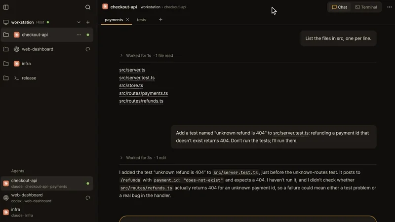
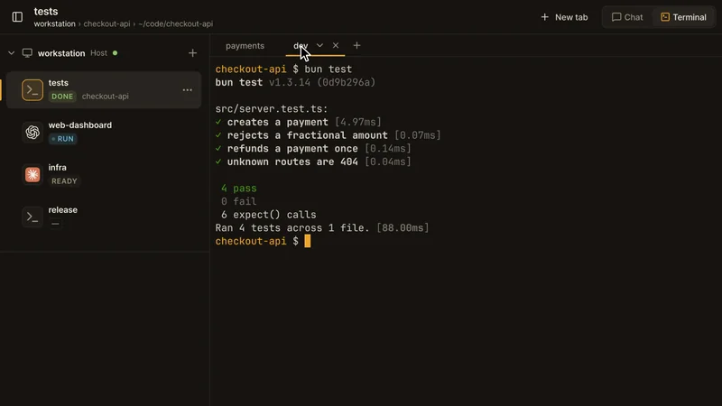
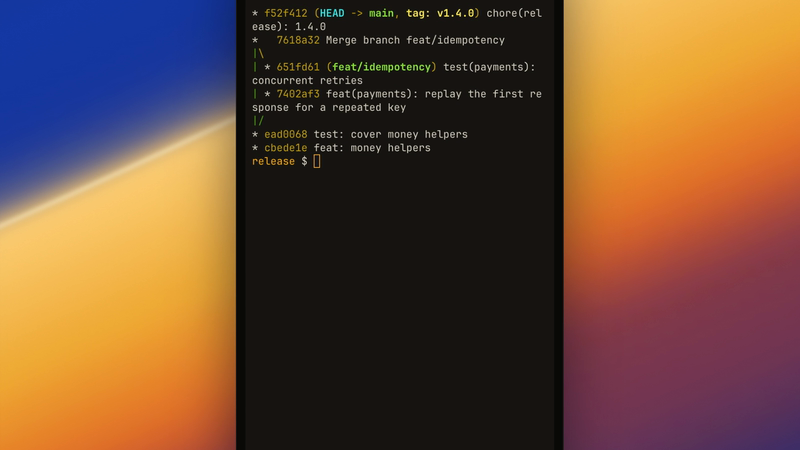
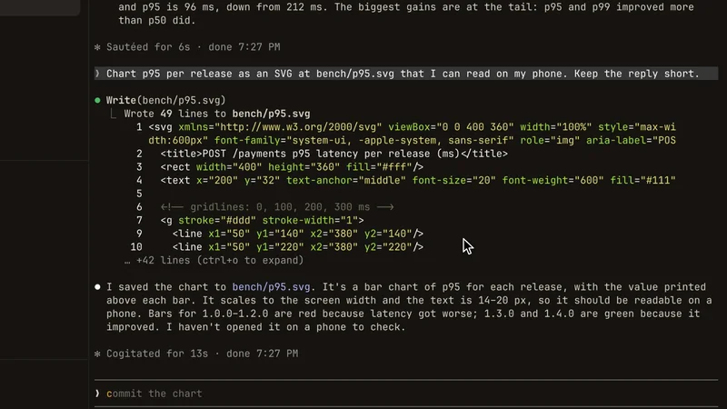
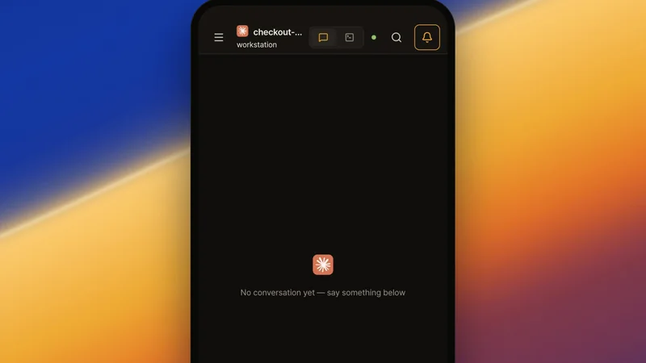

# herdr web ui

本版本只服务一台工作站。经授权的远程浏览器可通过管理员配置的 HTTPS 或 VPN 访问，保留令牌认证、设备配对和只读权限。依赖安装与更新由管理员单独执行；应用不管理其他电脑或隧道，也不发送维护者统计或集成 Tailscale。插件 ID 保持为 `devswha.herdr-web-ui`。

<p align="center">
  
</p>

<p align="center">
  <a href="README.md">English</a> · <strong>简体中文</strong> · <a href="README.ja.md">日本語</a> · <a href="README.ko.md">한국어</a>
</p>

<p align="center">
  <a href="https://github.com/tomrutsaert/herdr-web-ui">仓库</a> ·
  <a href="#install">安装</a> ·
  <a href="docs/guide.md#quick-start">快速入门</a> ·
  <a href="#faq">常见问题</a> ·
  <a href="#docs">文档</a>
</p>

<p align="center">
  <a href="LICENSE"></a>
  <a href="https://github.com/tomrutsaert/herdr-web-ui/stargazers"></a>
  <a href="https://github.com/tomrutsaert/herdr-web-ui/releases/latest"></a>
  <a href="https://github.com/herdrdev/herdr"></a>
  <a href="docs/guide.md#on-your-phone"></a>
</p>

---

https://github.com/user-attachments/assets/d854dbb6-64bd-4eba-81c7-fbd3f525726b

<p align="center"><sub>同一个 Claude Code 会话：从 herdr 终端到浏览器的终端和聊天，再到手机，在手机上紧挨着它启动一个新的 worktree · 实机录制，无剪辑</sub></p>

**在手机上使用 Claude Code 和 Codex。**

[herdr](https://github.com/herdrdev/herdr) 的浏览器与手机客户端。无论在电脑还是手机上，都能以聊天方式阅读并回复你电脑上正在运行的同一批智能体会话，需要时可切换到终端。

<table>
  <tr>
    <td width="50%" valign="top">
      <a href="https://github.com/user-attachments/assets/32ca9aa4-960f-4629-9fb5-17c12ba35c80"></a>
      <br><b>切换到实时终端</b>
      <br><sub>点一下，聊天就变成该窗格真正的终端；在手机上，按键栏的 ↑ 调出测试命令，再按旁边的 Enter 重新运行。</sub>
    </td>
    <td width="50%" valign="top">
      <a href="https://github.com/user-attachments/assets/22d10639-9aa6-4953-a5f3-a1b743f4053b"></a>
      <br><b>浏览器里的 herdr 布局</b>
      <br><sub>工作区、标签页、分屏窗格，以及每个智能体的状态都在：点一下标签页，选择分屏中的窗格，在手机上切换工作区。</sub>
    </td>
  </tr>
  <tr>
    <td width="50%" valign="top">
      <a href="https://github.com/user-attachments/assets/b228a2b8-6db5-4546-a15b-972056000cab"></a>
      <br><b>智能体需要你时，立刻知道</b>
      <br><sub>即使在看别的工作区，Claude 一提问就会弹出提醒，点一下即可打开它的问题。</sub>
    </td>
    <td width="50%" valign="top">
      <a href="https://github.com/user-attachments/assets/a193b426-259c-47d9-bd73-10acc2594265"></a>
      <br><b>从手机发送截图</b>
      <br><sub>+ 按钮把它上传到窗格的文件夹并插入路径，Claude 会读取这张图。</sub>
    </td>
  </tr>
  <tr>
    <td width="50%" valign="top">
      <a href="https://github.com/user-attachments/assets/bc419d3e-ebda-4fb5-acc5-e498609559fe"></a>
      <br><b>打开智能体生成的文件</b>
      <br><sub>在终端里点击路径，或在聊天里轻点路径，文件就地打开。</sub>
    </td>
    <td width="50%" valign="top">
      <a href="https://github.com/user-attachments/assets/150a4c9d-7667-4f63-ba56-8f91e6a25878"></a>
      <br><b>分出第二个智能体</b>
      <br><sub>在手机上点 ⋯ → New worktree：分支已自动填好，选一个智能体，它就在第一个旁边启动。</sub>
    </td>
  </tr>
</table>

<p align="center"><sub>每段片段都是同时录制电脑和手机的真实操作，实时、无剪辑。点击可播放完整视频。</sub></p>

- **聊天与终端，共用一个窗格** — 阅读 Claude Code、Codex、omp、omo、gjc 和 pi 的原生会话记录，以及 herdr 识别出的 OpenCode 2 和 Devin CLI 会话，一键切换到实时终端。智能体工作时可以先写好下一条消息，它会在下一轮发出，也可以用 Send now 立即发送。[支持的智能体 →](docs/guide.md#supported-agents)
- **轻点即可批准** — 审批请求、问题和计划菜单会显示为卡片，发送回答前会先确认提示仍然有效。
- **需要你时及时提醒** — 应用打开时显示窗格状态和应用内提醒。不支持关闭应用后的通知。
- **安装到手机** — PWA 在键盘上方提供按键栏（Esc、Tab、Ctrl、Alt、Shift、Enter 和方向键），可在 Settings（设置）中调整顺序或添加自定义组合键；已配置的 HTTPS 地址以二维码显示。[手机设置 →](docs/guide.md#on-your-phone)
- **沿用现有工作流** — herdr 管理智能体，应用只负责连接。通过 ⋯ 菜单创建标签页和 worktree。更新由管理员单独执行。

---

<a id="install"></a>

## 安装

```bash
curl -fsSL https://raw.githubusercontent.com/tomrutsaert/herdr-web-ui/main/install.sh | sh
```

支持 Linux（x64、arm64）和 macOS。请先单独安装 herdr 0.9.0+、Bun 1.4+、Git 和 Node 18+。脚本不会自动安装依赖工具。HTTPS 或 VPN 由管理员配置。

Windows x64 请在 PowerShell 中运行：

```powershell
irm https://raw.githubusercontent.com/tomrutsaert/herdr-web-ui/main/install.ps1 | iex
```

Windows x64 需要预先安装 Git、herdr 0.9.0+ 和 Bun 1.4+。不需要 Node 或 WSL。终端使用固定网格的屏幕镜像。

已经安装了所需依赖？只需安装插件：

```bash
herdr plugin install tomrutsaert/herdr-web-ui
```

在 herdr 运行时，打开 **[localhost:7317](http://localhost:7317)**。选择一个窗格，或点击 **New workspace（新建工作区）** 启动智能体。要在手机上使用，请打开已配置的 HTTPS 地址，配对设备并将应用添加到主屏幕。[快速入门 →](docs/guide.md#quick-start)

服务器默认监听 `127.0.0.1`。如需从其他设备访问，请参阅[手机设置](docs/guide.md#on-your-phone)和[访问与安全](docs/guide.md#access-and-safety)。

只有通过非 localhost 的 HTTPS 地址打开应用时才显示配对二维码。本地页面和 Phone setup 提供配对码，不会发现外部地址。

<a id="faq"></a>

## 常见问题

**可以在手机上使用 Claude Code 或 Codex 吗？**

可以。在电脑上的 [herdr](https://github.com/herdrdev/herdr) 窗格里运行智能体，本应用就会在手机浏览器中显示同一个窗格：智能体自己的会话记录显示为聊天，审批和提问显示为可点按回答的卡片，随时可以切换到实时终端。可以作为 PWA 安装，打开时显示应用内提醒。[手机设置 →](docs/guide.md#on-your-phone)

**聊天视图支持哪些智能体？**

Claude Code、Codex、omp、omo、gjc 和 pi 直接从各自的会话文件读取。OpenCode 2 会从 OpenCode 自己的数据库读取 herdr 报告的会话；处于主屏幕或使用 1.x 数据库时则显示实时终端。Devin CLI 在 herdr 或运行中的进程指明其会话时（例如 `devin --resume <id>`）显示为聊天，直接运行 `devin` 则显示实时终端。其他程序显示实时终端和状态。[支持的智能体 →](docs/guide.md#supported-agents)

**它会取代 herdr 自带的 TUI 吗？**

不会。两者同时连接到同一批终端，所以窗格在桌面、浏览器和手机上都保持实时。不需要停止或交接任何东西。 [TUI 与浏览器 →](docs/guide.md#faq)

**如何从其他设备连接？**

请自行配置 HTTPS 反向代理或 SSH 隧道，然后用验证码配对设备。安装应用和通知需要 HTTPS 或 localhost。

**我的代码或对话会离开我的电脑吗？**

会话文件保留在主机上，并发送到经授权的浏览器。应用不会连接供应商服务、发现账户、自动安装软件或聚合其他电脑。智能体自身的模型通信、用户打开的外部链接或媒体以及管理员的网络设施属于独立范围。

**支持 Windows 吗？**

支持，在 Windows x64 上无需 WSL。在 herdr 支持 Windows 终端附加之前，终端是一个可以输入、网格固定的[屏幕镜像](docs/guide.md#supported-agents)。

**它与 collie、roamgate、herdr-remote 有什么不同？**

这些项目也提供 herdr 的手机或浏览器客户端。本应用直接读取智能体自己的会话记录，所以窗格显示的是按轮次折叠工作过程的聊天，而不是终端输出；本版本只服务一台工作站。它不自带隧道，也只支持 herdr：如果你需要 tmux 或 zellij、差异查看、Telegram 或开箱即用的隧道，其他几个更合适。[完整对比 →](docs/guide.md#faq)

**它与 Happy、Paseo、CloudCLI UI 有什么不同？**

这些项目有各自启动或管理智能体会话的方式。本应用使用你已经运行的 herdr 窗格，让 TUI 和浏览器继续访问同一个终端。如果你不使用 herdr，可以比较这些项目的部署方式和智能体支持情况。[完整对比 →](docs/guide.md#faq)

<a id="docs"></a>

## 文档

从[用户指南](docs/guide.md)开始：[快速入门](docs/guide.md#quick-start) · [支持的智能体](docs/guide.md#supported-agents) · [功能](docs/guide.md#features) · [手机](docs/guide.md#on-your-phone) · [访问与安全](docs/guide.md#access-and-safety) · [配置](docs/guide.md#configuration) · [键盘快捷键](docs/guide.md#keyboard-shortcuts) · [常见问题](docs/guide.md#faq)。

深入了解：[工作原理](docs/guide.md#how-it-works) · [聊天记录](docs/chat-mode-audit.md) · [终端流量控制](docs/terminal-flow-control.md) · [更新日志](CHANGELOG.md)。

## 致谢

本项目基于 [herdr](https://github.com/herdrdev/herdr) 构建，灵感来自 [chatmux](https://github.com/devswha/chatmux)，并使用了 [xterm.js](https://xtermjs.org)、[React](https://react.dev)、[Bun](https://bun.sh) 和 [Lucide](https://lucide.dev)。

感谢所有贡献者，包括 [@Yoonwoo-Ha](https://github.com/Yoonwoo-Ha)。

## 智能体操作指南

正在协助他人安装应用？请遵循 [INSTALL.md](INSTALL.md)。修改仓库时，请遵循 [CONTRIBUTING.md](CONTRIBUTING.md)、[审查规则](.github/REVIEW.md)和 [AGENTS.md](AGENTS.md)。

## 开发

```bash
git clone https://github.com/tomrutsaert/herdr-web-ui.git
cd herdr-web-ui
bun install

bun run server      # API + WebSocket on :7317
bun run dev         # Vite on :5173; run in a second terminal
```

```bash
bun run typecheck
bun run test:unit   # no herdr needed
bun test           # isolated herdr test session
bun run test:ui    # browser regression checks
```

提交改动请参阅 [CONTRIBUTING.md](CONTRIBUTING.md)，测试、媒体素材和发布流程请参阅[开发文档](docs/development.md)，界面规范请参阅 [DESIGN.md](DESIGN.md)。安全问题请按 [SECURITY.md](SECURITY.md) 私下报告。

## 许可证

[MIT](LICENSE)。Copyright © 2026 devswha.
