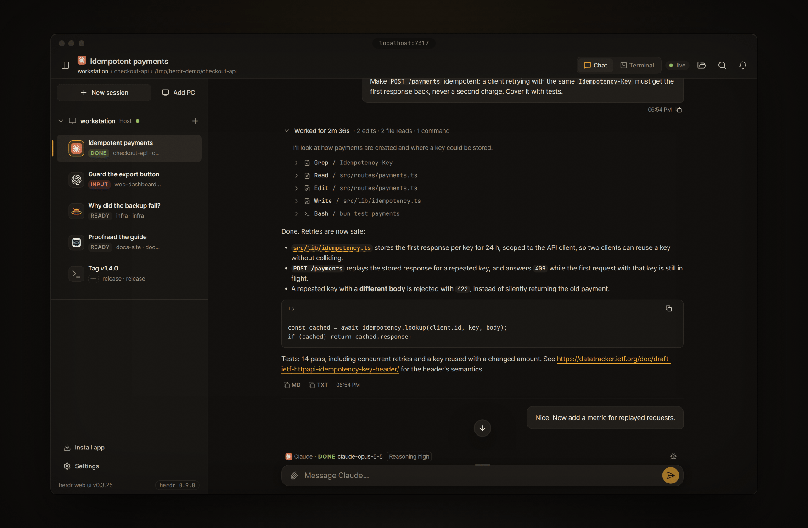
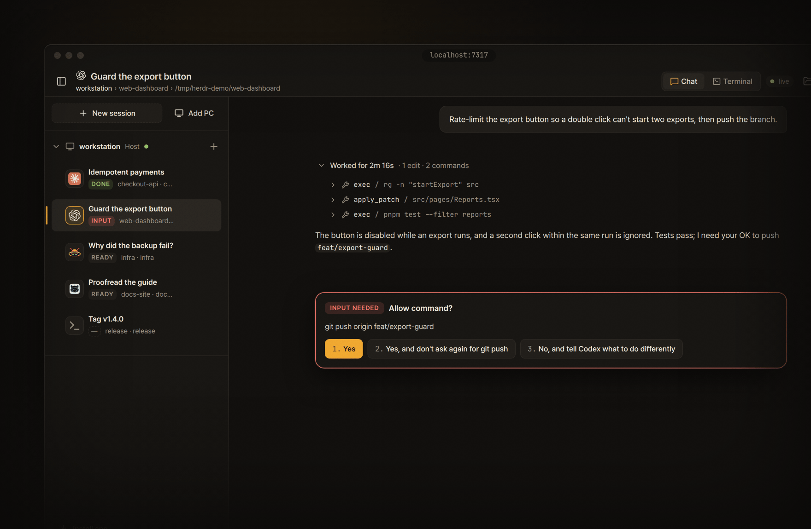
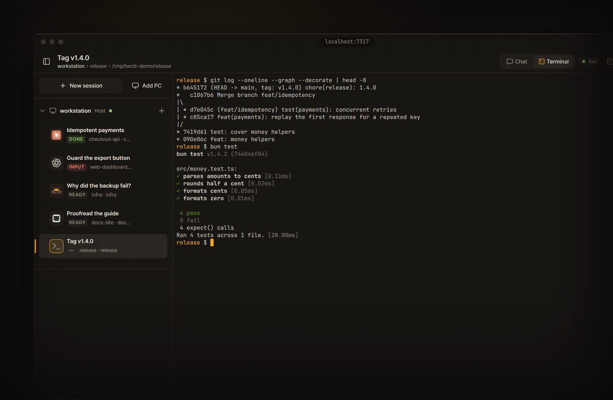
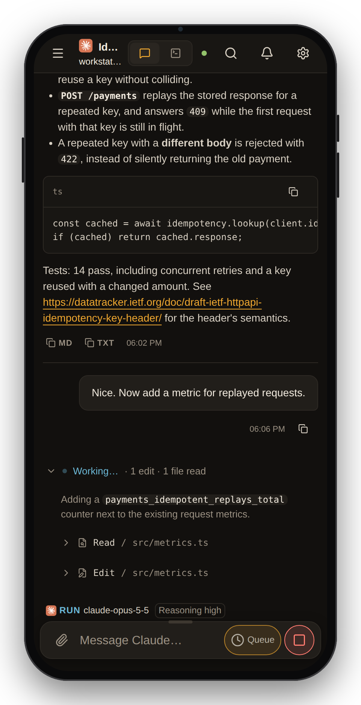
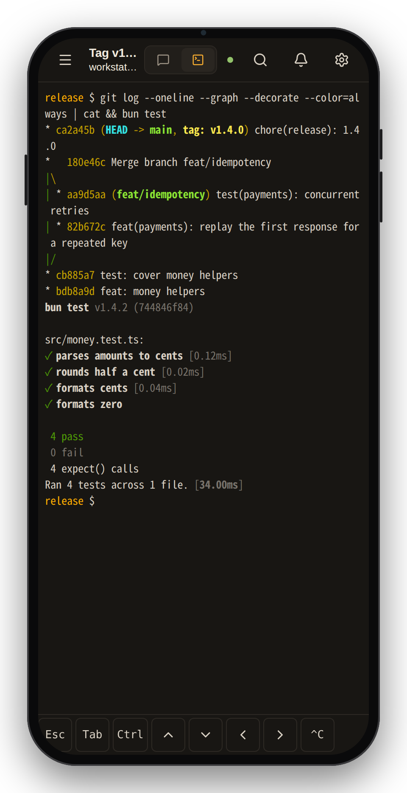
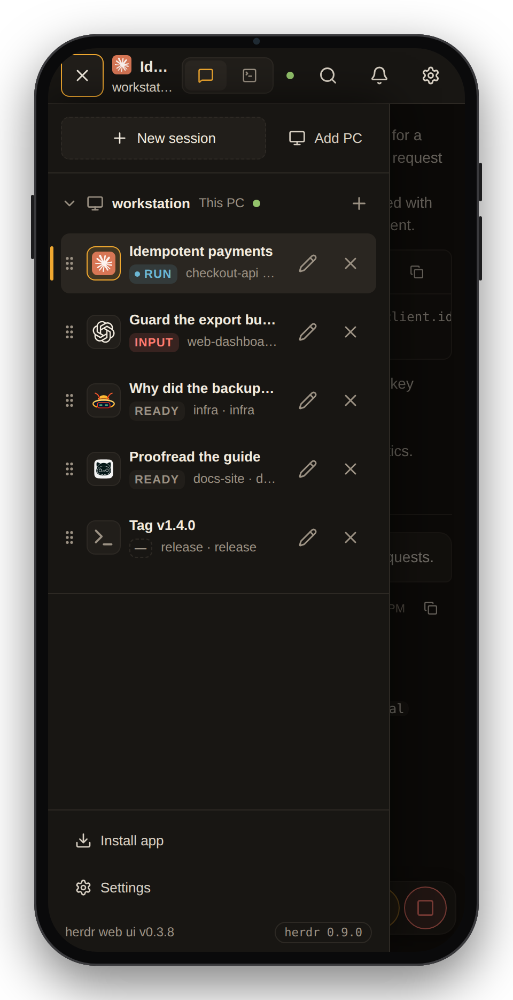
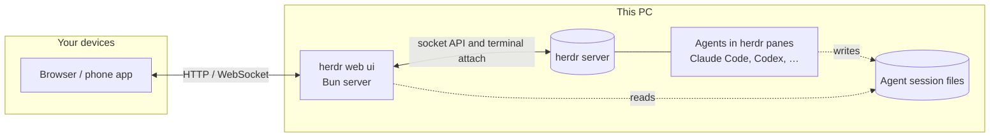

# User guide

[← README](../README.md) · [Quick start](#quick-start) · [Supported agents](#supported-agents) · [Features](#features) · [Phone](#on-your-phone) · [Access and safety](#access-and-safety) · [Configuration](#configuration) · [Keyboard shortcuts](#keyboard-shortcuts) · [How it works](#how-it-works) · [FAQ](#faq)

Install, connect and use herdr web ui on your desktop and phone.

## A look around

<table>
  <tr>
    <td colspan="2"></td>
  </tr>
  <tr>
    <td colspan="2" align="center"><b>Chat</b>: the agent's own transcript, each turn's work folded into one line you can open</td>
  </tr>
  <tr>
    <td width="50%"></td>
    <td width="50%"></td>
  </tr>
  <tr>
    <td align="center"><b>Answer prompts</b>: approvals and questions become cards, answered from the chat</td>
    <td align="center"><b>Terminal</b>: the same pane, live, through<br><code>herdr terminal attach</code></td>
  </tr>
</table>

<p align="center">
  
  
  
  
</p>

<details>
<summary><b>▶ Watch the demos in HD</b> (desktop 1920×1200, phone 1080×1920)</summary>

https://github.com/user-attachments/assets/4ca73671-ebfc-4c18-b8f2-99331abf9fa7

https://github.com/user-attachments/assets/2f030569-1004-425e-835d-9e775ec6e4c8

</details>

## Quick start

> **Setting it up with a coding agent?** Point it at [INSTALL.md](../INSTALL.md), a step-by-step guide written for agents.

Install prerequisites separately, then follow [operator installation](../INSTALL.md). A source deployment
uses `bun install --frozen-lockfile`, `bun run build`, then `bun run start`. Startup only runs that
prepared checkout. The plugin helpers fail on missing prerequisites instead of installing them.

### In a terminal

**Phone access:** configure an HTTPS reverse proxy or private SSH tunnel separately. Open
**Phone setup** in herdr, or run `bun scripts/plugin.ts phone-setup` from a source checkout,
to display secure-access guidance and a fresh pairing code. The app never publishes a route.

**A pairing code, on a PC with no browser of its own:**

```bash
root=$(herdr plugin list --json | bun -e 'const d = JSON.parse(await Bun.stdin.text()); console.log(d.result.plugins.find((p) => p.plugin_id === "devswha.herdr-web-ui")?.plugin_root ?? "")')
bun "$root/scripts/plugin.ts" pair   # plugin install
bun scripts/plugin.ts pair           # from a checkout
```

`pair` prints a code to enter at your configured app address. Neither is a herdr action: herdr keeps an action's output in its log, and a pairing code belongs on the screen. The actions start, stop and report on the server:

```bash
herdr plugin action invoke devswha.herdr-web-ui.start    # leaves a running server alone
herdr plugin action invoke devswha.herdr-web-ui.status
herdr plugin action invoke devswha.herdr-web-ui.phone    # visible phone setup pane
herdr plugin action invoke devswha.herdr-web-ui.stop
```

Its PID and log live under `HERDR_PLUGIN_STATE_DIR`. For persistent settings (see [Configuration](#configuration)), add `KEY=value` lines to the `env` file (no dot) in the directory that `herdr plugin config-dir devswha.herdr-web-ui` prints. A plugin checkout from 0.3.25 on also reads `.env` there, which wins where both set a key; an older one needs an operator-managed deployment first. The plugin's `status` prints the files it read. Protect that file if it holds a token.

### Uninstall

```bash
herdr plugin action invoke devswha.herdr-web-ui.stop
herdr plugin uninstall devswha.herdr-web-ui
```


## Supported agents

Every agent herdr runs shows up with its live status, terminal and alerts. The chat view reads the agent's own session files wherever it knows where they are:

| Agent | Chat | Answer prompts from chat |
| --- | --- | --- |
| **Claude Code** | Native transcript, resolved through herdr | ✓ approvals, questions, plan and menu picks, and the `/model` list (picked for the session) |
| **Codex** | Native rollout, with tool results and commentary/final phases | ✓ approvals and questions, including queued ones, and the `/model` lists (picked for the session) |
| **omp** | Native session file | ✓ |
| **omo** | Native session file, found through the pane's process tree | ✓ the `/model` list (picked for the session); other menus — use Terminal |
| **gjc** | Native session file identified by GJC's SDK broker and the pane's process | — use Terminal |
| **pi** | Native session file, resolved through herdr; after `/tree`, the branch in play | ✓ its dialogs: a question, a confirmation, an answer typed in |
| **OpenCode** | Native session in OpenCode 2's own database, resolved through herdr: `~/.local/share/opencode/opencode.db` (`%USERPROFILE%\.local\share\opencode\opencode.db` on Windows), or where the server's `XDG_DATA_HOME` or `OPENCODE_DB` puts it | — use Terminal |
| **Devin CLI** | Native SQLite session, showing the active branch when herdr or the live process explicitly identifies the session; otherwise terminal text | — use Terminal |
| **Grok** | Linux native update log. Any Grok executable named `grok` or `grok-…` whose one held session matches Herdr; macOS, Windows, and an ambiguous hold use Terminal. See [Grok setup and limits](grok-chat.md). | — use Terminal |
| **Hermes** | Native SQLite session store | — use Terminal |
| **Antigravity (agy)** | **Experimental; macOS untested.** Native ledger, selected by the running process’s held conversation lock. Linux native-tested; Windows uses terminal text. See [Agy behavior and limits](agy-chat.md). | — use Terminal |
| **Anything else** | The terminal's text | — use Terminal |

GJC chat requires GJC 0.18.9 or later for its broker-bound SDK session CLI, with `gjc`
on the server PC's PATH and its SDK broker already running. An older GJC opens in Terminal.
Git must also be on PATH for the SDK's workspace-scope discovery.
The bridge asks the broker which saved session belongs to the pane's GJC process;
it does not start a broker or guess from the screen, session title or newest file.
Missing, ambiguous or unreadable SDK identity uses Terminal instead. Terminal input,
status tracking and prompt handling are unchanged.

Devin sessions are never selected by directory or recency alone. A plain `devin` shows the
terminal text, since herdr does not report its session without its Devin integration; a session
started with `devin --resume <id>` (or `-r <id>`, as Devin suggests when it exits) is a chat.
Missing, ambiguous or
unreadable history uses the terminal-text fallback, including histories beyond the reader's
5,000-node or 8 MiB bounds. Long tool output is shortened with a truncation marker; use
Terminal for the rest. The database is opened read-only, though SQLite may create its
WAL coordination files beside it.

When the last visible line is a familiar password, SSH passphrase or PIN request, both
views show a **Password or PIN** field. It hides what you type and sends it directly
to the terminal with Enter. The value is cleared on send, cancel, disconnect, pane
change or when the page goes into the background. It never enters the message queue,
draft storage or chat history. A changed prompt or busy pane refuses the send; check
the terminal before entering it again. **Cancel** sends Ctrl+C. bundle v6. Detection covers a narrow list of English prompts, not every program or language.

A ring by the message box shows how much of the model's context the last request filled, and
its exact token counts on a tap. A pi pane shows it once `~/.pi/agent/models.json` states that
model's window, which is the file pi reads its own providers from; a model it states no window
for shows no ring rather than a guessed one, because pi answers those from a catalogue or a
running llama.cpp server that this app cannot ask. The model and reasoning effort come from what the session recorded, never from answer text. A todo list shows where the agent recorded it, in the turn's work block: Claude Code's `TodoWrite`, Codex's `update_plan`, or omp, omo and gjc todo calls. Plain-text plans are not reconstructed, and Claude Code `TaskCreate` / `TaskUpdate` calls are not drawn in the work block: the task list they build is the pane's plan, below. Details and verification are in the [chat-mode audit](chat-mode-audit.md).

Background tasks have a button by the message box, with a count while some run: an OmO pane's `task` children, and a Claude Code pane's subagents (the `Agent` tool), read from the session's own files. A Claude Code pane's background commands (`run_in_background`, Ctrl+B, or one moved there by its timeout) are listed with them. It lists what runs and the newest ten that ended in the last day, and the sidebar badge shows the running count. A Claude Code turn that ends while work it started still runs reads **BG**, not DONE: that work's notice starts the next turn by itself, and the finish is alerted once, when that turn ends (a turn is held at most 30 minutes). A subagent that ends leaves a card in the chat with its answer, and a Claude Code subagent whose pane no longer runs that session reads as lost.

A pane's plan is the task list a Claude Code agent keeps (`TaskCreate` / `TaskUpdate`) or the checklist Codex keeps (`update_plan`), read back from the session's transcript. While there is one, the background-task button by the message box starts with **Plan** and how many of its steps are done (`2/5`); the same button opens one list with the plan's steps first and the background tasks below. Steps are listed so a step comes after the steps it waits on (Claude Code's `blockedBy`; a Codex step waits on the one before it). The running step says what it does now, and each step shows how long it took. The sidebar row carries the same count. Claude Code empties its task list once every task is done, and so does this: the first task after that starts a new plan. A teammate of an agent team that changes a task writes that in its own transcript, which is not read.

## Features

| | |
| --- | --- |
| **Read the conversation** | Prompts and Markdown answers (links, code blocks, tables). Each turn's commands, edits and progress are folded into one "Worked for …" block. Copy an answer as Markdown or plain text. In a pi pane, a picture the agent's own tool opened shows inside that tool's row. A picture opens in a full-screen viewer: zoom at the pointer, pan, step through the message's other pictures, **Copy image** and **Download**. Skill names an answer writes (`/name`, or `$name` for Codex) show as chips when the pane's own command list names that skill. Once you have sent four or more messages, a rail of dashes at the left, one per message you sent, jumps between them (not on a phone, or when the chat column leaves less than 32 px of margin at each side). |
| **Follow the plan** | A supported todo-tool call folds into the turn's work block like any tool: it reads as the done count or the step it took, and opened, as the whole list by phase. |
| **Drop into the real terminal** | xterm.js on the live pane: full-screen TUIs, raw keys and herdr's scrollback, shared with your own herdr TUI. Drag to select and it is copied on release; the wheel or the screen's edge scrolls further back while you drag. Ctrl+C copies a selection instead of interrupting. **Quote in message**, shown while text is selected, adds the selection to that pane's chat draft in a code block headed by the pane name, and its line numbers when herdr reports them; nothing is sent. |
| **Find in terminal** | **More → Find in terminal** or Mod+Shift+F searches literal text in herdr's history, with a match count, previous/next navigation and visible match highlights. Search jumps and scrolling move the same viewport in every attached client, including the TUI. Older bridges retain search navigation without automatic highlights. |
| **Find panes and actions** | The command palette (Mod+Shift+K) searches this workstation by workspace, branch, tab, pane title or agent kind. Recent remembers panes you opened; unavailable or stale targets are omitted. It also finds Settings pages and actions by related words (try `theme` or `font`), and browses folders: type a path such as `~/`, or pick **Browse folders**, and the folder you reach opens in Files. |
| **Answer prompts** | Approval, question and plan menus become cards. Tap an option, or type its number in the composer. The server checks that the menu is still current before answering. |
| **Compose** | `/` commands and `@` file mentions, any file or image up to 32 MB attached by path, and a draft per pane. Send during work schedules a next-turn message; use its ↑ Send now action to send it now. A strip under the input card names the pane's working folder (the whole path on hover) and, for a workspace of a repository with a worktree open, its branch at the other end; a phone leaves it out. |
| **Follow every agent** | Live RUN / INPUT / DONE / READY status for all panes, and alerts when an agent needs input, finishes or its terminal ends. |
| **Open what agents make** | A file path in an answer opens in a viewer (images, video, audio, PDF, text), or find it with **Browse files**, and download it to your phone. A source file opens whole up to 8 MB and 200,000 lines; past 2,000 lines it scrolls as a window of rows, colored up to 256 KB and 5,000 lines and plain beyond. A link with `:line` or `#L12` opens at that line. |
| **See what changed** | **Browse files → Changes** lists what changed in the git repository the pane sits in: the **Working tree**, what is **Staged**, or two **Commits** you name, as a folder tree with git's status letter and the added and removed lines. A row opens its diff, **Unified** or **Split** (Settings → Chat → File viewer → Diff layout; a phone shows one column), with **Copy path**, **Copy patch** and **Open file**. The files a turn's edit tools changed, listed in its work block, open the same diff. It only reads the host workstation's repository. |
| **Manage sessions** | Start an agent in a folder you type or pick with **Browse**. In New workspace, Browse filters the currently loaded folders as you type (case-insensitive); opening a folder updates Directory, so **Start** uses that path even without **Use this folder** (which closes Browse), and a folder under home stays written as `~/…`. **New folder** (the folder-plus button in Browse's bar) makes a folder inside the one shown and opens it. It does not search subfolders or folders beyond the displayed 500. Add a tab to a workspace (as herdr's prefix+c), switch tabs from the strip over the pane, rename workspaces from their ⋯/right-click menu and panes from their own menu, reorder workspaces (drag a row, or on a phone long-press it and drag; Alt+Up/Down moves a focused row one step), and jump anywhere from the command palette. |
| **Make it yours** | English, Korean, Japanese or Simplified Chinese, following the browser or chosen in Settings. Dark, light or system mode, with a dark theme and a light theme picked from Amber, Charcoal, Codex, Catppuccin, the dark-only OLED and herdr's built-in themes, compact density, interface size, terminal and chat fonts and sizes (Chromium lists the installed fonts to pick from), a resizable composer, Enter behavior and thinking visibility. |

Every agent has the same chat controls on desktop and phones: Stop while it works with an empty
draft, Send when you type, and Send at rest. With a draft in the box, Escape stops the agent. Sending during work adds a message bubble above the
input card. It waits for the current response, then goes to the agent's next turn. Use a pending message's
**↑ Send now** action to send it now. The bridge immediately delivers it; when the agent reads
it is controlled by that agent, so this does not promise instant interruption. The small X discards it.
The bridge claims the same message ID for Send now and an automatic send, so they cannot both
deliver it. discarded after checking the terminal. Previously held browser messages still need **Send now**
or **Discard**. A message is never pasted over text typed in Claude Code's own input box: while
that box holds a draft the message stays in the list with the reason, and **Send now** delivers it
once the draft is sent or cleared in the terminal.

## On your phone

Configure your own **HTTPS reverse proxy** or a private SSH forwarding path to the loopback
server. The app does not discover or publish network routes. Set `HERDR_WEB_TOKEN` before
exposing a proxy, and follow [Access and safety](#access-and-safety).
**Settings → Phone & devices** shares a QR code only when this browser has opened the app at
a non-loopback HTTPS address. A local loopback page cannot discover that external address and
shows pairing codes and setup guidance instead. The terminal’s **Phone setup** action prints
a pairing code, not a discovered address or QR code.
Pairing uses a ten-minute code from a signed-in device or the terminal's `pair` command.

1. Open the address.
2. Install the app: in Safari, choose **Share → Add to Home Screen**; in Chrome, choose **Install app**. Each PC installs as an app of its own: set `HERDR_WEB_APP_NAME` on each to tell them apart (see [Configuration](#configuration)).
3. Open the **⋯** menu at the top right and tap **Alerts** to turn on alerts for that device. Alerts require an open app tab; closed-app alerts are not supported.

On a phone:
- Agent panes open in the chat.
- The terminal gets a key bar above the keyboard (Esc, Tab, Ctrl+C, Ctrl, Alt, Shift, Enter, arrows).
  Ctrl, Alt and Shift stay held until tapped again and combine with each other.
  The terminal starts in direct typing, where they combine with letters and symbols; the
  keyboard button switches to an input line you edit before sending. Herdr encodes each chord
  for the program's keyboard protocol; legacy protocols cannot distinguish every chord (for example Ctrl+I and Tab).
  Draft text in the input line is sent unchanged. Modifiers clear
  when leaving the pane or terminal view, or when the connection drops.
  **Settings → Terminal → Key bar → Edit key bar** opens a separate screen to add, remove and
  reorder every key, including modifier
  buttons. Register a custom combination such as Ctrl+W, choose editing keys or F1–F12, or restore
  the default row. Saved combinations use exactly their selected modifiers; ordinary keys use
  the currently held modifiers. Removing a held modifier button clears it.
- Dragging the terminal scrolls the real herdr pane.
- **Settings → Phone & devices → Keep screen on** keeps the screen awake while a terminal or chat
  pane is open. It is off by default, releases when the app is hidden, and resumes when
  you return. It needs HTTPS or localhost and browser support; power-saving mode may refuse it.

On a computer, install the app from `http://127.0.0.1:7317`. When the app runs on a PC you reach over SSH, tunnel to it first with `ssh -L 7317:127.0.0.1:7317 <this-pc>` and open that address on your own computer; the installer prints this line when you install over SSH.

A plain HTTP LAN address also works in the browser, but installing the PWA and browser notifications require a secure context.

In-app alerts and optional tab notifications come from the open browser, with no vendor push service. Local transcript metadata supplies session statistics; no provider account or usage endpoint is queried.

## Access and safety

The server listens on `127.0.0.1` by default. Anyone admitted with drive access can type into
terminals, read files and use configured provider credentials, so protect the address.

| How you reach it | What gets you in |
| --- | --- |
| Local loopback, no proxy evidence | No credential unless a token is configured |
| SSH local forward opened as localhost | The same loopback policy |
| Forwarded or foreign-host request through loopback | Valid token or paired-device cookie, even before the first pairing |
| Direct non-loopback bind | Open only while no token is configured and no device has been confirmed; set a token or pair devices before exposing it |
| Operator-managed HTTPS reverse proxy or VPN | Set a token and follow the proxy rules below |

**Settings → Phone & devices** starts a six-digit, one-use pairing code valid for ten minutes.
Five wrong attempts spend it. A paired browser keeps its credential in an HttpOnly cookie.
Revocation closes its terminal and roster connections. The first confirmed cookie closes the
external gate permanently: revoking every device never reopens it. A lost pairing response can
be retried without locking the owner out. The terminal's `pair` command prints a code on a
headless PC; do not put codes in logs.

A configured token (`HERDR_WEB_TOKEN`) gates local clients too; paired devices still work.
A proxy identity header never grants access. Without a token, direct loopback remains available
for recovery even if the device registry is damaged. Never send a token or terminal traffic over
untrusted cleartext HTTP: use HTTPS or a private SSH tunnel.

### Behind a reverse proxy

**Set a token first** (`HERDR_WEB_TOKEN`). A proxy on this PC connects from this PC, so the server knows a proxied request only by what the proxy sends: an `X-Forwarded-For` header (or another forwarding header), or a `Host` that is not `localhost` or `127.0.0.1`. A proxy that sends neither makes every visitor count as this computer: they get in with nothing, and pairing a device does not close it. nginx's plain `proxy_pass` is such a proxy. With a token set, every visitor needs the token whatever the proxy sends.

The proxy has to do four things:

- keep the browser's `Host`, so the app's own requests are not refused as coming from another site (`invalid_origin`);
- send `X-Forwarded-For`, so a visitor is not taken for this computer;
- send `X-Forwarded-Proto: https` when it serves HTTPS, so cookies are marked Secure and the app's own requests are accepted;
- pass the WebSocket upgrade for `/ws`, which carries the terminal.

Caddy does all four by default, and gets the certificate itself:

```caddyfile
herdr.example.com {
	reverse_proxy 127.0.0.1:7317 {
	}
}
```

nginx does none of them by default:

```nginx
map $http_upgrade $connection_upgrade {
    default upgrade;
    ''      close;
}

server {
    listen 443 ssl;
    server_name herdr.example.com;
    ssl_certificate     /etc/letsencrypt/live/herdr.example.com/fullchain.pem;
    ssl_certificate_key /etc/letsencrypt/live/herdr.example.com/privkey.pem;

    location / {
        proxy_pass http://127.0.0.1:7317;
        proxy_http_version 1.1;
        proxy_set_header Host $http_host;
        proxy_set_header X-Forwarded-For $proxy_add_x_forwarded_for;
        proxy_set_header X-Forwarded-Proto $scheme;
        proxy_set_header Upgrade $http_upgrade;
        proxy_set_header Connection $connection_upgrade;
        proxy_read_timeout 1h;
        proxy_buffering off;
    }
}
```

The `map` block goes in the `http` section. `proxy_read_timeout` keeps an idle terminal connected, and `proxy_buffering off` lets the local session stream update live.

**If the proxy already signs people in** (basic auth, Authelia, oauth2-proxy, Cloudflare Access and the like), let it hand the app the token, so nobody signs in twice and Settings stops warning that this address is open. Set `HERDR_WEB_TOKEN`, then have the proxy send it on every request it lets through, the terminal's `/ws` connection included. In Caddy, inside `reverse_proxy`:

```caddyfile
		header_up Authorization "Bearer {env.HERDR_WEB_TOKEN}"
```

In nginx, inside `location /`:

```nginx
        proxy_set_header Authorization "Bearer <your token>";
```

The proxy's own sign-in is then the only one: anyone it lets through gets in, and nobody needs to pair a device. Settings then offers no **Sign out**: the proxy would send the token again with the next request, so signing out is done at the proxy. Keep the app's port closed to everything but the proxy, as `HOST=127.0.0.1` does.

To check the app's gate, request its `/api/session` directly without a token: it must answer 401.
If the proxy signs people in, also check that a signed-out visitor cannot reach the app through
the public address.

**Sign out** in Settings → Devices clears, after asking once, this browser's token and device cookies; terminal sessions and agents keep running. It is shown when this browser signed in with the token or as a paired device, not when a proxy sends the token in the `Authorization` header (sign out at the proxy) or for automatic local access.

If `devices.json` under `HERDR_WEB_STATE_DIR` (default `~/.config/herdr-web-ui`) is corrupt or unreadable, the server keeps unrecognized external clients out and preserves the file. Direct loopback without a configured token, and a valid token, still work. Settings → Phone & devices and the server log explain the error. Restore a valid registry from backup or fix its permissions, then restart; pairing and device changes remain disabled until it is repaired.

Nothing is typed without you:
- Input typed while disconnected waits as a draft for you to send or discard.
- On a current bridge, a message sent while the agent works goes to its next turn on its own, but only while the connection that sent it stays open and still holds the pane. Switching tabs or workspaces on the same PC keeps that pane attached until its automatic queue settles. Losing the connection or lease cancels delivery, even if the connection rejoins later. A reload or reconnect never resumes that: the saved copy of such a message comes back marked not confirmed, to copy or discard after checking the terminal. Other held messages stay with their PC and pane until you choose **Send now** or **Discard**. If the browser cannot save the queue, it says so: keep the tab open or copy the messages before reloading.
- A typed answer that picks an option of an approval, plan or menu waits for **Confirm**.

Attaches and reconnects wait when another client holds the terminal. **Open here** on the waiting
notice explicitly takes that pane with `--takeover`: the other web bridge waits in turn, while a
standalone `herdr terminal attach` exits. The herdr TUI stays connected (verified on herdr 0.9.3).
Observe connections cannot take a pane, and a displaced bridge never takes it back automatically.

## Configuration

| Variable | Default | Purpose |
| --- | --- | --- |
| `HOST` | `127.0.0.1` | Bind address. Use `0.0.0.0` or a LAN address only with `HERDR_WEB_TOKEN` set or once a device is paired: until then that address is open to anyone who reaches it (see [Access and safety](#access-and-safety)). |
| `PORT` | `7317` | HTTP and WebSocket port. Left unset, the plugin takes the next of 17317, 27317, 37317 and 47317 when 7317 cannot be opened (another program has it, or Windows reserves it for Hyper-V, WSL2 or Docker), keeps that port for later starts, and the installer and the **herdr web ui status** action print the address. A port set here is never changed |
| `HERDR_SOCKET` | `~/.config/herdr/herdr.sock` | herdr socket for API calls and terminal attach. For a named session, use `~/.config/herdr/sessions/<name>/herdr.sock`. A plugin follows the socket of the herdr session that starts it; `HERDR_SOCKET` in the plugin config overrides that. |
| `HERDR_WEB_TOKEN` | unset | Shared token for scripts and proxies. Once set, every client that is not a paired device needs it, this computer included |
| `HERDR_WEB_CSP` | unset (enforced) | `report-only` sends the policy as `Content-Security-Policy-Report-Only`: the browser reports what it would block and the app keeps working. Used to measure the policy after a change |
| `HERDR_WEB_STATE_DIR` | `~/.config/herdr-web-ui` | Paired devices, shared preferences and local completion state |
| `HERDR_WEB_HERDR_BIN` | `herdr` | herdr executable used for terminal attach |
| `HERDR_WEB_APP_NAME` | unset (`herdr`) | The name the installed app has on a phone or computer, for example the PC's name. Each PC installs as an app of its own, and without it they are all called `herdr`. An app already installed takes the new name when the browser next updates it, usually within a day or two, without a reinstall. Keep it short: a home screen cuts a long label |
| `HERDR_WEB_PASTE_DIR` | `<pane cwd>/.herdr-web-ui` | Where pasted and attached files are saved: an absolute path or `~/…`. Set it to keep them out of your projects; an agent may then ask before reading one. It covers the panes of this server's PC |
| `HERDR_WEB_MEDIA_ROOTS` | unset | Folders besides its own that a rendered HTML page may play a video or sound from, through a symlink beside it or a `../` link: absolute paths separated by `:` (`;` on Windows), for example a network share where recordings are kept. Any page can then find out which files exist there. Unset, a page plays its large videos only from its own folder, so a page that came with its own symlinks cannot find out which of this PC's files exist. A large video plays from an address made for that render: it works only from the device's network address that opened the page, for 30 minutes (reload the page after that), and stops when that device is revoked or signs out. The page's own script can read that address and share it, so for those 30 minutes anyone behind the same network address can play that file too |
| `CODEX_HOME` | `~/.codex` | Where Codex sessions are read |

## Keyboard shortcuts

`Mod` is **⌘** on Apple platforms and **Ctrl** elsewhere. Global app shortcuts add Shift, so the terminal keeps its own Ctrl keys. These are the defaults:

| Shortcut | Action |
| --- | --- |
| `Mod+Shift+K` | Command palette |
| `Mod+Shift+J` | Switch Chat / Terminal |
| `Mod+Shift+E` | Focus the current pane's message box, terminal input line or terminal |
| `Mod+Shift+PageUp` / `PageDown` | Scroll the current pane up / down, retaining one line |
| `Mod+Shift+B` | Toggle sidebar |
| `Mod+Shift+O` | New workspace (`Mod+Shift+N` too, in the installed app: a Chrome tab keeps `Ctrl+Shift+N` for an incognito window) |
| `Mod+Shift+↑` / `↓` | Previous / next pane |
| `Mod+Shift+,` | Settings |

Selecting a pane or opening chat focuses its message box on desktop, while touch screens keep
focus where it was. **Mod+Shift+E** focuses the selected pane's input in any mode, including the
terminal's input line and direct input; it prefers masked input while a secret prompt is open. The
shortcut can be reassigned or disabled in Settings → Shortcuts.

**New tab**, **Split pane right** and **Split pane down** have no default key: pick one in
**Settings → Shortcuts**, and the command palette shows it beside the action.

**Settings → Shortcuts** changes each app binding or turns it off: press **Record** on a row,
then the new chord (Escape cancels). A Mod+Shift chord is always safe for the terminal. Other
chords are kept exactly as pressed, such as `⌘+PageUp` or `Ctrl+K`, and need Ctrl, Alt or (on a
Mac) ⌘. Letters, digits, the punctuation keys, arrows, PageUp/PageDown and Home/End can be bound. A
punctuation key is read by where it sits, so on a Hungarian keyboard É is the key US labels `;`, and
the binding works on any layout; the row shows your keyboard's own character where the browser says it. A chord the browser, the OS or text editing keeps (`Mod+W`/`T`/`N`, `⌘+Q`, `Mod+C`/`V`/`X`/`A`/`Z`,
`Ctrl+PageUp`/`PageDown`, macOS `Ctrl+arrows`), an unbindable key or an already-assigned chord is
refused on the row. Plain Ctrl or Alt chords are shells', editors' and agents' keys (`Ctrl+R`,
`Ctrl+A`/`E`, Alt word moves): the row says so and saves one only after **Save anyway**, and from
then on that key no longer reaches the pane. A ⌘ chord the browser commonly uses (such as `⌘+S`,
`⌘+L` or `⌘+⌥+I`) asks the same way. The row's list still picks a Mod+Shift letter, digit,
arrow or PageUp/PageDown without a keyboard; Home, End and the punctuation keys are bound with Record. A search field filters the list. Settings
are saved in this browser, not on the host workstation. The command palette shows the current bindings
and omits disabled ones. Reset shortcuts restores the defaults.

Known browser/OS reservations are marked, but other combinations can also be intercepted by
your browser, OS or extensions. Installed-app mode may behave differently. While an IME is
composing, keys stay with it. In a text field with text, a binding on an arrow, Home or End keeps
its text-selection behavior; from an empty one, such as the chat's empty message box, they switch panes.
List and tab controls also have focus-local keys; those do not become global terminal shortcuts.
On a focused tab, Alt+Shift+Left/Right reorders it and Shift+F10 opens its menu. For the pane menu
on desktop, tab to the pane header's **⋯** (it appears on keyboard focus) and press Enter.
Shift+F10 inside the terminal stays with the terminal program.

On a phone, use the header, the tab's ⋯ and the More menu for app actions. The command palette
and its plugin actions are not available in the phone touch UI. Use a wider screen or an external
keyboard's `Mod+Shift+K` shortcut (or your configured binding).
The terminal key bar is configured separately under **Settings → Terminal**.
An external keyboard uses the same app bindings as a desktop.

Plain PageUp/PageDown scroll the chat transcript, even while its message box is focused;
the draft, caret, selection and focus stay intact. Modified page keys, composition,
other editable controls and modal input retain their own behavior. Plain terminal page keys
continue to belong to the running program.

Paging shortcuts work while the message box is focused, preserving the draft, caret and selection.
Chat scrolls its transcript immediately; Terminal scrolls herdr's shared history, so other
clients see the same terminal position. When herdr explicitly reports zero native history,
the shortcut instead sends plain PageUp/PageDown to the running application through its live
input lease. That application owns its page length.
Unavailable or invalid history data never causes application input, and no key is queued
while disconnected.
One line stays visible between pages. Chat uses the displayed text's line height, and Terminal
uses native rows. A page still advances by at least one pixel in chat or one terminal row.
For an iPad with an external keyboard that lacks PageUp/PageDown, assign letters such as
U and D to **Scroll pane up** and **Scroll pane down** in Settings → Shortcuts (Mod+Shift+U/D,
or record a chord such as `⌘+U`). This lets you read history without leaving the message box or reaching for
the screen. Shift+PageUp/PageDown alone retains the focused control's own behavior.

Enter sends and Shift+Enter adds a line. On a touch screen, Settings → Chat → Composer → Return inserts a new line lets Return add a line instead; use Send to send the message. On a desktop, turning off Enter sends switches sending to Mod+Enter. On a touch screen with a hardware keyboard, Mod+Enter sends while Return inserts a new line is on. This choice is saved per device.

## How it works



A React client talks to one workstation's Bun HTTP/WebSocket server, through operator-managed HTTPS/VPN access when remote.

- **Status:** the server reads workspaces and agent status from herdr's Unix socket.
- **Terminal:** it streams the real `herdr terminal attach` output through a Node PTY sidecar. Browsers watching one pane share one attach, with a bounded replay and backpressure ([terminal flow control](terminal-flow-control.md)).
- **Chat:** it reads the agents' own session files, and sending types into the same live pane.

herdr owns the processes and the scrollback.

## FAQ

<details>
<summary><b>Does it replace herdr's own TUI?</b></summary>

No. Both attach to the same terminals at the same time. Use the TUI at your desk and the web app anywhere else. Nothing needs to be stopped or handed over.
</details>

<details>
<summary><b>How do I reach the app from another device?</b></summary>

Use your own HTTPS reverse proxy or a private SSH forward. HTTPS or localhost is required to
install the PWA and receive alerts. Set a token before exposing a proxy and pair each device.

</details>

<details>
<summary><b>Does my code or conversation leave my machine?</b></summary>

Session files stay on the PC running each agent, and their contents are sent to browsers connected to the app. herdr web ui has no hosted relay or account service of its own. The agents' own connections to model providers depend on their configuration.

The app does not initiate vendor-service requests, runtime downloads or software installation.
Operator infrastructure and agents’ own model traffic are separate. Files, external links and media
explicitly opened by the user can also refer to other services.

See [Access and safety](#access-and-safety) for who can connect to the app.
</details>

<details>
<summary><b>An agent is missing from the chat, or shows only terminal text.</b></summary>

The chat needs the agent's own session file. Check that the agent runs in a herdr pane on this PC (or on an added PC) and has already written its first message. Agents without a native reader always get the terminal-text view, and the Terminal view always works.
</details>

<details>
<summary><b>The colors look too dark, or the light theme looks dark, in Samsung Internet.</b></summary>

Samsung Internet has a forced dark mode that repaints every page, including one that brings its own light and dark themes, as this app does. A light theme comes out dark, and a dark one is darkened a second time: similar shades run together, and status marks can lose contrast. Turn off **Force dark mode for web content** (**웹 콘텐츠에 어두운 화면 모드 강제 적용**) in Samsung Internet's settings, or open the app in Chrome. Reported on a Galaxy Tab S7+ ([#451](https://github.com/devswha/herdr-web-ui/issues/451)).
</details>

<details>
<summary><b>How is this different from collie, roamgate or herdr-remote?</b></summary>

All three are in the herdr plugin marketplace too, and each does something this app does not. [collie](https://github.com/AltanS/collie) is a mobile terminal for herdr, tmux and zellij, with a status dashboard, a key pad, quick replies and voice input, served over Tailscale by its own bridge. [roamgate](https://github.com/powerfooI/roamgate) is a browser client for herdr with a file explorer and diff annotations, installed by its own script. [herdr-remote](https://github.com/dcolinmorgan/herdr-remote) is a macOS menu-bar app with a phone dashboard and a Telegram bot behind a relay and a free tunnel.

herdr web ui reads the agent's own transcript, so Claude Code, Codex, omp, omo, gjc, pi, OpenCode and identifiable Devin CLI panes are a chat with the work folded per turn. Supported prompt cards are checked against the live menu before an answer is typed; Devin prompts use Terminal. The terminal is the same live pane as your TUI, it serves one workstation and can be deployed as a herdr plugin, with no server or account of its own. It brings no tunnel: you reach it over SSH or your own HTTPS proxy. If you want tmux or zellij, diffs, Telegram or a tunnel out of the box, one of the others is the better fit.
</details>

<details>
<summary><b>How is this different from Happy, Paseo or CloudCLI UI?</b></summary>

Those projects start and manage agents through their own wrapper, daemon or server, and bring their own apps. herdr web ui adds nothing between you and the agent. It is a window onto the herdr sessions you already run, so the same pane is live in your terminal, your browser and your phone at once. If you don't use herdr, one of those is the better fit.
</details>
